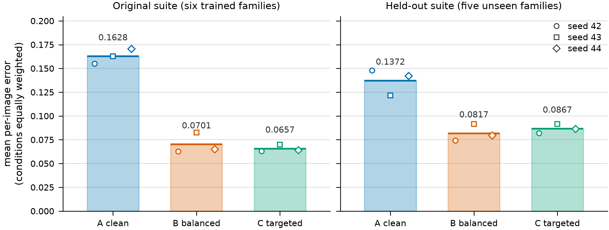

# Traffic sign recognition under image corruption

Kamaal Alag

This project tests whether training a traffic-sign classifier with corruption
augmentation aimed at its measured weaknesses improves robustness more than
sampling corruption families uniformly. I compare clean training, balanced
augmentation and weakness-targeted augmentation across nine CNN checkpoints on
GTSRB (43 classes), with the two augmented policies matched on augmentation
rate and severity distribution so that only the family weighting differs. All
nine are evaluated on the official test split, against both the corruption
families used in training and a set of held-out synthetic perturbations. The
final evaluation protocol was frozen before the official test split was used to
measure model performance.

**Main result.** Balanced augmentation reduced mean corruption error by about
57 percent on the original suite and about 40 percent on the held-out suite
relative to clean training, and it was lower at every training seed on both
suites. Targeted augmentation improved the original-suite average slightly but
did not beat balanced augmentation consistently across seeds, and it was worse
than balanced augmentation on the held-out suite at all three seeds. The
predefined success criterion for the targeted policy was therefore not met. No
statistical test across seeds was performed, so these are observed directions
and spreads rather than statistically established effects.

## Research question

Does allocating more augmentation probability to the corruption families that
cause the largest baseline performance degradation improve robustness compared
with balanced sampling?

A second question runs alongside it: how far does either form of augmentation
carry to corruption types never sampled during training? A policy that only
helps on the families it trained on is a narrower result than it first appears,
so both are also evaluated on a held-out suite.

## Experimental design

Three training policies, three seeds each (42, 43, 44), giving nine
checkpoints.

| Arm | Policy | Training distribution |
|---|---|---|
| A | `clean` | no corruption augmentation |
| B | `balanced` | uniform over the six corruption families |
| C | `targeted` | reweighted towards the families A handles worst |

The architecture, optimiser, schedule, epoch budget and batch size are
identical across all nine runs, and every checkpoint is selected on clean
validation macro F1, so corrupted performance never influences selection. B and
C corrupt each training image with probability 0.5 and draw one severity
uniformly from levels 1 to 5. The only difference is the family distribution: B
gives each family weight 1/6, while C's weights come from the clean baseline's
per-family accuracy drop measured on the validation split, normalised with a 5
percent floor and fixed before any augmented training ran — occlusion 0.42,
gaussian_noise 0.22, fog 0.15, brightness_bright 0.09, brightness_dark 0.06,
gaussian_blur 0.06.

Severity is drawn before the family, from the same table in both arms, and the
per-image seed does not depend on the policy, so B and C at the same seed
augment the same images at the same severities and differ only in which family
lands. That is what makes the B-versus-C contrast a test of the weights rather
than of the augmentation rate. Arm A at seed 42 is the accepted baseline
checkpoint, reused rather than retrained.

**Data.** The torchvision GTSRB training archive holds 26,640 images in 888
tracks of 30 frames, one track per physical sign, split at the track level so
no sign contributes frames to both sides. An image-level split of this archive
put 887 of the 888 tracks on both sides, which would leave validation close to
a memorisation check.

| Split | Tracks | Images |
|---|---:|---:|
| Training | 710 | 21,300 |
| Validation | 178 | 5,340 |
| Official test | — | 12,630 |

**Corruption suites.** Corruptions are synthetic transformations with five
discrete severity levels each.

| Suite | Families | Conditions |
|---|---|---:|
| original | brightness_bright, brightness_dark, fog, gaussian_blur, gaussian_noise, occlusion | 31 |
| held-out | contrast_reduction, jpeg_compression, motion_blur, rotation, salt_pepper | 26 |

Each suite's conditions are its families at severities 1 to 5 plus one clean
condition, which is excluded from every corruption-error average and reported
separately. The code and result files name them `frozen` and `heldout`. The
held-out suite holds out corruption *types*, not images: both suites are
applied to the same 12,630 official test images, so it measures transfer to
unseen perturbations rather than generalisation to new signs or cameras.

Full details are in the frozen
[augmentation](docs/augmentation_protocol.md) and
[final test](docs/final_test_protocol.md) protocols, with recorded departures
in [docs/final_test_deviations.md](docs/final_test_deviations.md).

## Results

Mean per-image error under corruption on the official test split: error per
image on each condition, then a mean over that suite's corrupted conditions
with every condition weighted equally. Clean conditions are excluded. Lower is
better, and all values are averaged over the three training seeds. Both suites
use the same official test images.

| Suite | A: clean | B: balanced | C: targeted |
|---|---:|---:|---:|
| original | 0.1628 | 0.0701 | 0.0657 |
| held-out | 0.1372 | 0.0817 | 0.0867 |

Paired within-image contrasts, negative favouring the left arm:

| Suite | Contrast | Mean | Seed 42 | Seed 43 | Seed 44 | Favouring left |
|---|---|---:|---:|---:|---:|---|
| original | B−A | −0.0926 | −0.0921 | −0.0801 | −0.1057 | 3 of 3 |
| original | C−A | −0.0971 | −0.0918 | −0.0928 | −0.1066 | 3 of 3 |
| original | C−B | −0.0045 | +0.0003 | −0.0128 | −0.0009 | 2 of 3 |
| held-out | B−A | −0.0555 | −0.0737 | −0.0302 | −0.0624 | 3 of 3 |
| held-out | C−A | −0.0505 | −0.0658 | −0.0300 | −0.0556 | 3 of 3 |
| held-out | C−B | +0.0050 | +0.0079 | +0.0002 | +0.0069 | 0 of 3 |

Augmenting at all is the large effect: both augmented arms are lower than clean
training at every seed on both suites. Balanced augmentation's per-seed
reductions range from 49 to 62 percent on the original suite and from about 25
to 50 percent on the held-out suite, so the direction repeats more reliably
than the size. Only one contrast fails to repeat across seeds, and only on the
original suite: the targeted policy's 0.0045 advantage there is an average over
seeds that disagree, two supporting it and one reversing it. On the held-out
suite balanced augmentation is lower at all three seeds.

**The predefined success criterion and its outcome.** The rule was fixed with
the design, before any test image was classified: C is preferred over B only if
C's mean per-image error is lower than B's at every one of the three training
seeds, on both suites. C is lower at two of three seeds on the original suite
and at none of the three on the held-out suite, so the criterion is not met and
the targeted weighting is not preferred over balanced augmentation. The
protocol's 0.01 clean-accuracy limit is a reporting rule that sits alongside
the verdict rather than a pass condition; no arm came near it.

Clean test accuracy is about 98.2 percent for all three policies: 0.9820,
0.9825 and 0.9822 for A, B and C averaged across seeds, a span of 0.00053. No
arm pays a meaningful clean-accuracy cost for its robustness. The per-family
and per-severity breakdowns, the bootstrap procedure and its assumptions, the
validation-against-test comparison and the class-balanced sensitivity analysis
are in [docs/final_test_findings.md](docs/final_test_findings.md). The interval
endpoints and the full per-class tables stay in `paired_contrasts.csv` and
`per_class_recall.csv` under `artifacts/analysis/final_test/`, which is not
committed.

## Figures



Figure 1. Mean per-image error under corruption for each policy on each suite,
averaged over seeds 42, 43 and 44. Bars are the across-seed mean; the open
markers are the three individual seeds. The markers show seed spread and are
not uncertainty intervals.

* [Figure 2](figures/fig2_per_family_contrasts.png) — the B−A and C−B
  differences family by family, both columns ordered by the B−A effect so the
  rows line up. Each contrast column shares a horizontal scale across the
  original and held-out suites; the B−A and C−B columns have different scales.
* [Figure 3](figures/fig3_severity.png) — error against severity levels 1 to 5
  for each policy, and the C−B difference at each level.
* [Figure 4](figures/fig4_clean_versus_corruption.png) — clean accuracy against
  corruption error for all nine checkpoints.

## Interpretation

The improvement from augmenting at all grows with severity, from 0.021 at
severity 1 to 0.186 at severity 5 on the original suite, and it carries to
corruption types the model never trained on: held-out error is lower than A's
at every seed, and four of that suite's five families improve on the
across-seed mean.

Within the augmented arms, the targeted policy improved occlusion, the family
it weighted most heavily, at all three seeds, and gave mixed or worse results
on the other families. That pattern is consistent with a trade-off from
concentrating augmentation on occlusion, but this experiment cannot isolate the
effect of raising one family's weight from that of lowering the others, since
no intermediate weighting was trained. These are observations about where the
differences fall, not a demonstrated mechanism.

The targeted policy did not meet its predefined success criterion. That is
evidence against the particular weighting tested, under this architecture, this
dataset and these synthetic corruption settings. It does not show that targeted
augmentation fails in general, and it does not rule out a different weighting
rule or weights derived from a broader set of families.

## Reproducing the study

[docs/reproduction.md](docs/reproduction.md) is the full workflow behind the
reported results, from a fresh clone through the official test stage, with
every prerequisite and one-shot restriction. Three things worth separating
first.

*Rerunning the methodology* is supported, with one manual prerequisite at the
official-test stage, which needs a checkpoint inventory that is not committed
and that no module here generates. *Reproducing the reported numbers* is not
expected to match bit for bit, since checkpoints and predictions are not
committed and different backends use different kernels and reduction orders.
*Regenerating the committed figures from the original analysis tables* is not
possible from a clone: the plotting script reads the Git-ignored
`artifacts/analysis/final_test/`, and refuses any analysis directory that does
not record the official test split. The figures can be regenerated only after
the official-test evaluation and comparison stages have been rerun, and then
from that rerun's numbers. Section 1 of the guide has the detail.

Quick start, from the project root:

```sh
python3 -m venv .venv
.venv/bin/pip install -r requirements.txt
.venv/bin/python -c "from torchvision.datasets import GTSRB; \
GTSRB(root='data', split='train', download=True); \
GTSRB(root='data', split='test', download=True)"
```

Nothing in `src/` enables torchvision's `download` flag, so the dataset has to
be fetched explicitly as above. Once `data/` is populated, these three run on a
fresh clone and train nothing:

```sh
.venv/bin/python -m src.verify_data_pipeline
.venv/bin/python -m src.verify_model
.venv/bin/python -m src.verify_corruptions
```

`src.verify_data_pipeline` decodes 64 official test images on every run, to
check batch shape, dtype and pixel range across all three splits. It builds no
model and makes no prediction, so no test performance information comes out of
it, but the test split is not completely untouched; Part 8 of
[docs/final_test_protocol.md](docs/final_test_protocol.md) records that access.
A fourth check, `src.verify_augmentation`, needs the uncommitted baseline
checkpoint and so fails on a fresh clone. Section 4 of the guide has the
detail.

One training run, as an example of the three entry points, and the figure
command once `artifacts/analysis/final_test/` exists:

```sh
.venv/bin/python -m src.train_augmented --policy balanced --seed 42
.venv/bin/python -m src.plot_paper_figures
```

## Repository structure

```
src/        data pipeline, model, the three training entry points, the two
            corruption suites, validation and official-test evaluation and
            comparison, verification utilities and plotting scripts
docs/       the frozen protocols, the reproduction guide, the findings
figures/    the four figures, PNG
notebooks/  01_data_exploration.ipynb
```

* [docs/reproduction.md](docs/reproduction.md) — the full workflow, with the
  data pipeline and the clean baseline's configuration in section 14,
  including the track-level split and checkpoint selection using macro F1
* [docs/augmentation_protocol.md](docs/augmentation_protocol.md) and
  [docs/final_test_protocol.md](docs/final_test_protocol.md) — the two frozen
  protocols, with departures recorded in
  [docs/final_test_deviations.md](docs/final_test_deviations.md)
* [docs/final_test_findings.md](docs/final_test_findings.md) — the results and
  their detailed limitations

## Limitations

* **Synthetic corruptions.** Severity levels are parameter settings, not
  calibrated physical conditions. Nothing here measures performance on real
  adverse-weather or night-time photographs.
* **One architecture, one dataset.** All results are for the 1.45M-parameter
  `BaselineCNN` on GTSRB at 64x64.
* **Three training seeds give a limited view of run-to-run variability.** No
  statistical test across seeds was performed, and seed variability is not
  pooled with image-level sampling uncertainty.
* **Bootstrap intervals treat test images as independent.** Because multiple
  frames may come from the same physical sign, these intervals may
  underestimate uncertainty. The official test release does not provide track
  identifiers needed to account for this clustering. The intervals do not
  establish significance, and none enters the success criterion.
* **The held-out suite is held out in corruption type only.** Both suites use
  the same 12,630 test images, and cross-split physical-sign overlap is assumed
  absent rather than verified, again for want of track identifiers.
* **The headline metric is image-weighted.** Official test support runs from 60
  to 750 images per class, and class-balanced error is higher for every arm on
  both suites. Class-balanced evaluation flips the sign of two of the eighteen
  per-seed contrasts, both C−B, at seed 44 on the original suite and seed 43 on
  the held-out suite. Neither flip changes the predefined verdict, which needs
  C lower at all three seeds on both suites.
* **The checkpoints and analysis artifacts are not committed.** `artifacts/` is
  Git-ignored entirely, so reproduction means retraining, and the checkpoint
  inventory the official-test stage requires has to be written by hand.
* **Not comparable with published GTSRB numbers.** The torchvision training
  archive used here holds 26,640 images, not the commonly cited 39,209-image
  variant.
