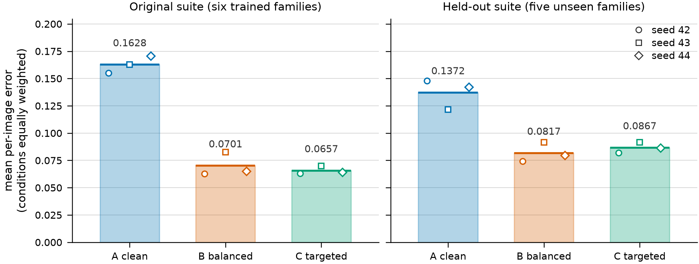

# Traffic sign recognition under image corruption

Kamaal Alag

**Paper:** [Evaluating Weakness-Targeted Corruption Augmentation for Robust
Traffic Sign Recognition](paper/Traffic_Sign_Robustness.pdf)

This project asks whether corruption augmentation works better when the
augmentation budget is concentrated on the corruption families a model already
handles worst, rather than spread evenly across families. I trained a
traffic-sign classifier on GTSRB under three policies — no corruption
augmentation, balanced augmentation over six corruption families, and
augmentation reweighted towards the families the clean baseline failed on — and
evaluated all nine resulting checkpoints on the official test split, both on the
families used in training and on a separate set of held-out corruption types.

Augmenting at all was the large effect: both augmented policies cut mean
corruption error well below clean training, at every seed, on both suites. The
targeted weighting did not produce the consistent improvement I was testing
for. It edged out balanced augmentation on average on the original suite but
won at only two of three seeds, and it was worse than balanced augmentation on
the held-out suite at all three. I had fixed the success criterion before any
test image was classified, and it was not met.

## Experimental setup

GTSRB, 43 classes. The torchvision training archive holds 26,640 images in 888
tracks of 30 frames, one track per physical sign, and I split it at the track
level: 710 tracks (21,300 images) for training, 178 tracks (5,340 images) for
validation. An image-level split of the same archive puts 887 of the 888 tracks
on both sides, which leaves validation close to a memorisation check. The
official test split provides a further 12,630 images.

One architecture throughout: a 1.45M-parameter CNN on 64x64 inputs. Three
training policies, three seeds each (42, 43, 44), nine checkpoints in total.
Optimiser, schedule, epoch budget and batch size are identical across all nine
runs, and every checkpoint is selected on clean validation macro F1, so
corrupted performance never influences selection. Arm A at seed 42 is the
earlier accepted baseline checkpoint, reused under that same configuration
rather than retrained.

| Arm | Policy | Training distribution |
|---|---|---|
| A | clean | no corruption augmentation |
| B | balanced | uniform over the six corruption families |
| C | targeted | reweighted towards the families A handles worst |

B and C both corrupt each training image with probability 0.5 and draw one
severity uniformly from levels 1 to 5. Only the family weighting differs. B
gives each family 1/6. C's weights come from the clean baseline's per-family
accuracy drop on the validation split, normalised with a 5 percent floor:
occlusion 0.42, gaussian_noise 0.22, fog 0.15, brightness_bright 0.09,
brightness_dark 0.06, gaussian_blur 0.06. The drops they came from are in
[results/baseline_validation_summary.csv](results/baseline_validation_summary.csv). Those are fixed constants, set before
any augmented training ran — nothing adapts during training. Severity is drawn
before the family from the same table in both arms, and the per-image seed does
not depend on the policy, so B and C at the same seed corrupt the same images at
the same severities and differ only in which family lands. That is what makes
the B-versus-C contrast a test of the weights rather than of the augmentation
rate.

Evaluation uses two suites of synthetic corruptions, each family at five
severity levels:

| Suite | Families | Corrupted conditions |
|---|---|---:|
| Original | brightness_bright, brightness_dark, fog, gaussian_blur, gaussian_noise, occlusion | 30 |
| Held-out | contrast_reduction, jpeg_compression, motion_blur, rotation, salt_pepper | 25 |

Each suite also scores one clean reference condition, reported separately and
excluded from every corruption average. The held-out suite holds out corruption
*types*, not images: both suites run over the same 12,630 test images.

The success criterion was fixed with the design. The targeted policy is
preferred over balanced only if its mean per-image corruption error is lower at
every one of the three seeds, on both suites.

Optimiser settings, the corruption parameter tables and the protocol mechanics
are in [docs/augmentation_protocol.md](docs/augmentation_protocol.md) and
[docs/final_test_protocol.md](docs/final_test_protocol.md), with recorded
departures in [docs/final_test_deviations.md](docs/final_test_deviations.md).

## Results

Mean per-image error under corruption on the official test split, averaged over
the three seeds and over each suite's corrupted conditions. Lower is better.

| Suite | Clean | Balanced | Targeted |
|---|---:|---:|---:|
| Original | 0.1628 | 0.0701 | 0.0657 |
| Held-out | 0.1372 | 0.0817 | 0.0867 |

Both augmented policies beat clean training on both suites at all three seeds.
For balanced augmentation that is a reduction of about 57 percent on the
original suite and about 40 percent on the held-out suite.

Targeted augmentation's 0.0045 advantage on the original suite is an average
over seeds that disagree: it is lower at two of the three. On the held-out suite
balanced augmentation is lower at all three. Because targeted augmentation did
not outperform balanced augmentation at every seed on both suites, it failed the
predefined success criterion.

Clean test accuracy is about 98.2 percent under all three policies — 0.9820,
0.9825 and 0.9822 averaged across seeds, a span of 0.00053 — so none of them
pays a meaningful clean-accuracy cost for its robustness.

This is evidence against the particular weighting I tested, on this
architecture, dataset and corruption settings. It does not show that
weakness-targeted augmentation fails in general, and it does not rule out a
different weighting rule or weights derived from a broader set of families.
Within the augmented arms, the targeted policy did improve occlusion, the family
it weighted most heavily, at all three seeds, and was mixed or worse on the
others. The experiment cannot separate the effect of raising one family's weight
from that of lowering the rest, since no intermediate weighting was trained.

Per-family and per-severity breakdowns, the bootstrap procedure, the
class-balanced sensitivity analysis and the validation-against-test comparison
are in [docs/final_test_findings.md](docs/final_test_findings.md). The aggregate
tables are in [results/](results/), with per-checkpoint digests and the frozen
protocol settings recorded in
[results/comparison.json](results/comparison.json).

## Figures



Mean per-image corruption error for each policy on both suites. Bars are the
across-seed mean; the open markers are the three individual seeds, showing seed
spread rather than uncertainty intervals.

* [Figure 2](figures/fig2_per_family_contrasts.png) — the B−A and C−B
  differences family by family, both columns ordered by the B−A effect so the
  rows line up.
* [Figure 3](figures/fig3_severity.png) — error against severity levels 1 to 5
  for each policy, and the C−B difference at each level.
* [Figure 4](figures/fig4_clean_versus_corruption.png) — clean accuracy against
  corruption error for all nine checkpoints.

## Reproducing the project

```sh
python3 -m venv .venv
.venv/bin/pip install -r requirements.txt
.venv/bin/python -c "from torchvision.datasets import GTSRB; \
GTSRB(root='data', split='train', download=True); \
GTSRB(root='data', split='test', download=True)"
```

Every call site in `src/` passes `download=False`, so the dataset is fetched
explicitly as above. Once `data/` is populated, three checks run without
training anything:

```sh
.venv/bin/python -m src.verify_data_pipeline
.venv/bin/python -m src.verify_model
.venv/bin/python -m src.verify_corruptions
```

`src.verify_data_pipeline` decodes 64 official test images on every run to check
batch shape, dtype and pixel range across all three splits. It builds no model
and makes no prediction, and that access is recorded in the test protocol.

The four figures rebuild from the published tables on a fresh clone, with
nothing trained and no image decoded. In the recorded environment, on the
pinned `matplotlib==3.11.2`, the PNGs come out byte-for-byte identical to the
committed ones; other matplotlib, FreeType or libpng builds re-encode the same
plot differently:

```sh
.venv/bin/python -m src.plot_paper_figures \
    --analysis-dir results --figure-dir /tmp/figures
```

The official-test stage is one-shot by construction: the pre-run check refuses
to start if `artifacts/final_test/` already exists and the evaluator refuses a
non-empty output directory, so an accidental second run cannot overwrite the
accepted results. It also reads a checkpoint inventory that no module here
generates; that file ships with the released checkpoints.

[docs/reproduction.md](docs/reproduction.md) is the full workflow — training,
validation and the frozen official-test procedure, with every prerequisite and
one-shot restriction.

## Trained checkpoints

All nine final checkpoints are published as a release:
[v1.0-checkpoints](https://github.com/Kamaal2002/traffic-sign-robustness/releases/tag/v1.0-checkpoints).
`artifacts/` is Git-ignored, so they are not in the repository itself.

The archive also carries the validation-stage records that bind each checkpoint
to its arm and seed, the per-image validation predictions for both suites, the
clean baseline's per-family validation sweep that the targeted weights were
derived from, and the checkpoint inventory the official-test stage reads. Paths
inside it are repository-relative, so it extracts into the project root as-is.
Download all three assets there and verify before extracting:

```sh
shasum -a 256 -c SHA256SUMS.archive.txt
tar -xzf traffic-sign-robustness-checkpoints-v1.0.tar.gz
shasum -a 256 -c SHA256SUMS.txt
```

Extraction overwrites files of the same name, so unpack elsewhere first if the
working copy already holds results.

With the archive in place, the official-test evaluation can be run from the
published weights instead of retraining, and the validation comparison and the
baseline failure analysis rebuild from the per-image predictions. Every
checkpoint's MD5 and SHA-256 were recorded in the inventory before the
official-test stage ran and are carried in
[results/comparison.json](results/comparison.json), so a download can be checked
against a record that predates the results. The weights carry no optimizer
state, so they support evaluation rather than resumed training. The archive does
not include the dataset, the official-test per-image output or the earlier
occlusion-placement stage.

## Limitations

* Corruptions are synthetic parameter settings, not calibrated physical
  conditions. Nothing here measures performance on real adverse-weather or
  night-time photographs.
* One architecture and one dataset: the 1.45M-parameter CNN on GTSRB at 64x64.
* Three seeds give a limited view of run-to-run variability, and no statistical
  test was run across seeds, so the reported directions and spreads are observed
  rather than statistically established.
* Bootstrap intervals treat test images as independent, which repeated frames of
  the same physical signs make unlikely, so they may understate uncertainty. The
  official test release carries no track identifiers to correct for it, and no
  interval enters the success criterion.
* The headline metric is image-weighted, and per-class test support runs from 60
  to 750 images. Class-balanced error is higher for every policy on both suites
  and flips the sign of two of the eighteen per-seed contrasts, neither of which
  changes the verdict.
* The held-out suite holds out corruption types, not a new image domain: same
  images, same signs, same cameras. Physical-sign overlap between the training
  and test splits is assumed absent rather than verified, again for want of
  track identifiers.
* Numbers depend on hardware. Each corrupted input is a function of its image
  index and condition, so the inputs reproduce exactly, with one exception:
  `jpeg_compression` decodes through whichever libjpeg build `torchvision` is
  linked against. The forward pass does not reproduce exactly either, since CPU,
  MPS and CUDA use different kernels and reduction orders. The reported results
  were produced on MPS with torch 2.14.1 and Python 3.13.1.
* Not comparable with published GTSRB numbers. The torchvision training archive
  used here holds 26,640 images, not the commonly cited 39,209-image variant.

Section 9 of [docs/final_test_findings.md](docs/final_test_findings.md) covers
the statistical limitations in detail.

## Dataset and license

The experiments use the German Traffic Sign Recognition Benchmark, fetched
through `torchvision.datasets.GTSRB`:

> J. Stallkamp, M. Schlipsing, J. Salmen and C. Igel. Man vs. computer:
> Benchmarking machine learning algorithms for traffic sign recognition.
> *Neural Networks*, 32:323-332, 2012.
> <https://doi.org/10.1016/j.neunet.2012.02.016>

No dataset archive is redistributed here or in the release. `data/` is
Git-ignored, and the exploration notebook
[notebooks/01_data_exploration.ipynb](notebooks/01_data_exploration.ipynb)
displays 53 sign crops as figures.

[LICENSE](LICENSE) places my original source code, documentation, figures,
notebook code and trained weights under MIT. The manuscript PDF is excluded and
remains under my copyright. GTSRB and material derived from its images,
including those sign crops, are outside the grant.
